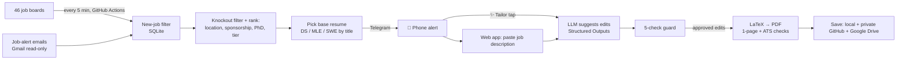

# ResumeFit: Real-Time LLM Resume Tailoring with Hallucination Guardrails

ResumeFit watches **46 company job boards** plus job-alert emails from Google, Microsoft,
Meta, Apple and LinkedIn, alerts me on my phone within minutes of a relevant posting, scores the right
one of my three base resumes against it, and tailors it with an LLM on one tap, while a
**rule-based guard blocks any invented fact**.

Built by **Shirisha Gajendra** · MS Data Science, Stony Brook University

## Results
- **65% → 73% ATS keyword match** on a sample Data Scientist posting using honest rewording only;
  **4 of 4** AI edits passed the hallucination guard (no invented numbers or skills)
- **46 companies** monitored (Greenhouse, Lever, Ashby, Workday and Amazon) plus big-company alert emails
- **Tap-to-PDF in about 3 minutes:** one Telegram tap returns the original and the tailored resume
- **70 automated tests** (pytest)

## How it works


## Features
| Area | What it does |
|---|---|
| **Job discovery** | Reads official public job APIs (Greenhouse, Lever, Ashby) plus Workday career feeds; remembers seen jobs in SQLite so only new postings alert |
| **Ranking + knockouts** | Target / Stretch / Reach tiers; skips jobs outside the U.S., with no sponsorship, citizenship/clearance, PhD-only, required certifications (ASA, CPA…), staff/manager level or 8+ years |
| **Three base resumes** | Data Scientist, ML Engineer and Software Engineer versions; the job title picks one, with a best-match fallback for unclear titles |
| **Email alerts** | Reads job-alert emails from big companies and LinkedIn (Gmail, read-only) and sends their jobs through the same pipeline, skipping duplicates |
| **Application log** | Logs "thank you for applying" and LinkedIn Easy Apply confirmations in the tracker, and marks rejections |
| **One-tap tailoring** | A Telegram button tailors the matching base resume and sends both PDFs plus a before/after edit list |
| **Daily summary** | Evening Telegram digest: alerts, tailored resumes and the day's best matches |
| **ATS scoring** | 77-skill dictionary with aliases and whole-word regex matching (e.g. "ML" ≠ "HTML", "R" ≠ "R&D"), plus a keyword-match score for the job's own wording |
| **AI tailoring** | OpenAI API with Pydantic Structured Outputs; the model may only reword existing bullets |
| **Hallucination guard** | Blocks any edit that adds a number, adds a skill not on the resume, removes an existing keyword, breaks LaTeX, or grows the bullet over 25% |
| **PDF checks** | Compiles with pdflatex and verifies 1 page, filled placeholders and ATS-readable text |
| **Tracking** | Application folders + tracker with status editing; auto-backup to a private GitHub repo and Google Drive (`drive.file` scope only) |
| **Skill Gap Engine** | Ranks missing skills across all saved job descriptions with a proof project for each |

## Tech stack
Python · OpenAI API · Pydantic · scikit-learn-style keyword scoring · Streamlit · Altair · SQLite ·
pdflatex · GitHub Actions · Google Drive + Gmail APIs (OAuth) · Telegram Bot API · pytest

## Privacy and security
- Phone and email are **never in the repo**: `{{PHONE}}` placeholders are filled at build time from secrets
- All keys live in Codespaces, GitHub Actions or Streamlit encrypted secrets
- Saved applications go to a **private** repo; the Drive integration can only see files it created
- Gmail access is **read-only** and limited to job-alert and application emails
- The web app is password-protected (`hmac.compare_digest`)

## Run it yourself
```bash
git clone https://github.com/siri780/resumefit.git && cd resumefit
pip install -r requirements.txt
cp .env.example .env   # add your keys
python -m streamlit run app/streamlit_app.py
python -m pytest -v
```

## Note
Built with AI-assisted development. I designed the architecture and the guardrail rules,
wrote the filtering and guard logic, and tested and debugged the system end to end.