# ResumeFit: Real-Time LLM Resume Tailoring with Hallucination Guardrails

ResumeFit watches **43 company job boards**, alerts me on my phone within minutes of a
relevant posting, scores my resume against it, and tailors my LaTeX resume with an LLM,
while a **rule-based guard blocks any invented fact**.

Built by **Shirisha Gajendra** · MS Data Science, Stony Brook University

## Results
- **65% → 73% ATS keyword match** on a sample Data Scientist posting using honest rewording only;
  **4 of 4** AI edits passed the hallucination guard (no invented numbers or skills)
- **43 companies** monitored (Greenhouse, Lever, Ashby and Workday); about **8,000 postings** per scan
- **29 automated tests** (pytest)

## How it works

```mermaid
flowchart LR
    A[43 job boards] -->|every 5 min, GitHub Actions| B[New-job filter<br/>SQLite]
    B --> C[Rank: tier, sponsorship,<br/>location, ATS score]
    C -->|Telegram| D[📱 Phone alert]
    D --> E[Web app: paste job description]
    E --> F[LLM suggests edits<br/>Structured Outputs]
    F --> G[5-check guard]
    G -->|approved edits| H[LaTeX → PDF<br/>1-page + ATS checks]
    H --> I[Save: local + private GitHub + Google Drive]
```


## Features
| Area | What it does |
|---|---|
| **Job discovery** | Reads official public job APIs (Greenhouse, Lever, Ashby) plus Workday career feeds; remembers seen jobs in SQLite so only new postings alert |
| **Ranking** | Target / Stretch / Reach / Long-shot tiers from title and years required; blocks citizenship and clearance roles; flags sponsorship; US-only filter |
| **ATS scoring** | 68-skill dictionary with aliases and whole-word regex matching (e.g. "ML" ≠ "HTML", "R" ≠ "R&D") |
| **AI tailoring** | OpenAI API with Pydantic Structured Outputs; the model may only reword existing bullets |
| **Hallucination guard** | Blocks any edit that adds a number, adds a skill not on the resume, removes an existing keyword, breaks LaTeX, or grows the bullet over 25% |
| **PDF checks** | Compiles with pdflatex and verifies 1 page, filled placeholders and ATS-readable text |
| **Tracking** | Application folders + tracker with status editing; auto-backup to a private GitHub repo and Google Drive (`drive.file` scope only) |
| **Skill Gap Engine** | Ranks missing skills across all saved job descriptions with a proof project for each |

## Tech stack
Python · OpenAI API · Pydantic · scikit-learn-style keyword scoring · Streamlit · Altair · SQLite ·
pdflatex · GitHub Actions · Google Drive API (OAuth) · Telegram Bot API · pytest

## Privacy and security
- Phone and email are **never in the repo**: `{{PHONE}}` placeholders are filled at build time from secrets
- All keys live in Codespaces, GitHub Actions or Streamlit encrypted secrets
- Saved applications go to a **private** repo; the Drive integration can only see files it created
- The web app is password-protected (`hmac.compare_digest`)

## Run it yourself
```bash
git clone https://github.com/siri780/resumefit.git && cd resumefit
pip install -r requirements.txt
cp .env.example .env   # add your keys
python -m streamlit run app/streamlit_app.py
python -m pytest -v
```

## Note
Built with AI-assisted development. I designed the architecture and the guardrail rules,
wrote the filtering and guard logic, and tested and debugged the system end to end.