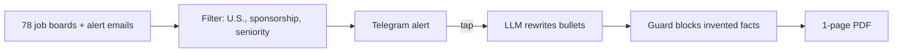

# ResumeFit: Real-Time LLM Resume Tailoring with Hallucination Guardrails

ResumeFit finds new jobs within minutes, picks the right one of my three resumes, and tailors it with an LLM on one tap, while a **rule-based guard blocks any invented fact**.

Built by **Shirisha Gajendra** · MS Data Science, Stony Brook University

## Results
- **65% → 73% ATS keyword match** on a sample Data Scientist posting, using honest rewording only
- **78 company job boards** plus LinkedIn and big-company alert emails, checked every 5 minutes
- **About 3 minutes** from a Telegram tap to a tailored, one-page PDF
- **100+ automated tests** (pytest), run on every change

## How it works

## Tech stack
Python · OpenAI API (Structured Outputs) · GitHub Actions · SQLite · Telegram Bot API · Gmail API (read-only) · Streamlit · pdflatex · pytest

## Source code
The source code is private because I use this tool for my own job search. **Code is available on request** for interviews: message me on [LinkedIn](https://www.linkedin.com/in/shirisha-gajendra) and I'll share access.

This repo runs the live watcher on a schedule with GitHub Actions. Secrets stay in encrypted GitHub secrets, never in code. Built with AI-assisted development; I designed the architecture and guardrail rules and tested the system end to end.
