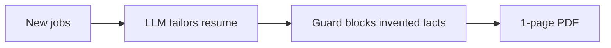

# ResumeFit: Real-Time LLM Resume Tailoring with Hallucination Guardrails

Built by **Shirisha Gajendra** · MS Data Science, Stony Brook University

## How it works

## Tech stack
Python · OpenAI API · GitHub Actions · SQLite · pytest

## Source code
Private. Available on request for interviews via [LinkedIn](https://www.linkedin.com/in/shirisha-gajendra).
